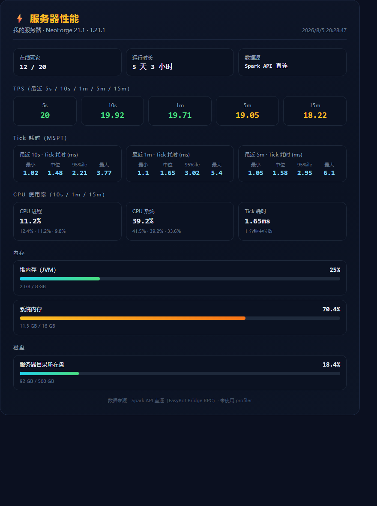

# easy-spark-obs

在 QQ 群聊 / 私聊发送 `性能`，机器人返回一张渲染好的服务器性能图表图片。

适用环境：**Youer 1.21.1（Bukkit + NeoForge 混合端）+ Spark（模组版或 Bukkit 插件版）+ EasyBot 插件版**。
不需要 EasyBot 模组，也不需要旧的服务器端 NeoForge 扩展 mod。

## 架构

```
EasyBot 主程序（Windows / .NET）
        │  WebSocket Bridge（RPC）
        ▼
EasyBot 插件版（Bukkit，plugins/EasyBot-2.4.0.jar）
        │  同一 JVM，进程内 Bridge 扩展 API
        ▼
SparkPerformance 插件（Bukkit，plugins/SparkPerformanceBridge-Bukkit-1.21.1-1.0.0.jar）
        │  Spark Java API（SparkProvider）
        ▼
Spark（mods/ 模组版 或 plugins/ Bukkit 插件版，二选一）
```

EasyBot 侧仍然是「主程序 ←→ 子程序（插件版）」的结构；服务器端采集逻辑从 NeoForge mod
改成了 Bukkit 插件，挂到 EasyBot 插件版的 Bridge 扩展上。数据仍走 Bridge 自己的
WebSocket RPC 通道，不经过命令输出，因此不受 EasyBot「命令只返回第一行」的限制，也不需要
PlaceholderAPI，并且**不使用 profiler**。

### 为什么 Bukkit 插件能直接调用 Spark

Spark 的 **Bukkit 插件版**和 **NeoForge 模组版**提供的是同一套公共 API：

- `me.lucko.spark.api.SparkProvider.get()`
- `me.lucko.spark.api.Spark` 的 `tps()` / `mspt()` / `cpuProcess()` / `cpuSystem()`
- `StatisticWindow` 的 `TicksPerSecond` / `MillisPerTick` / `CpuUsage` 窗口枚举

所以 `SparkMetrics` 只写一套代码，不需要为两种发行版分支。

类可见性由环境决定：

- **模组版 Spark（Youer）**：Bukkit 插件的 `PluginClassLoader` 父级是
  `cpw.mods.modlauncher.TransformingClassLoader`，它持有 NeoForge 的 GAME layer，
  所有 mod 都在这一层里，因此 `me.lucko.spark.api` 对插件可见。已在 Youer 1.21.1 +
  NeoForge 21.1.264 + Spark 1.10.124 测试服上实测。
- **Bukkit 插件版 Spark**：`plugin.yml` 里有 `softdepend: [spark]`，Spigot/Paper
  插件类加载器会把 Spark 插件加入可访问组，`SparkProvider.get()` 拿到 Bukkit Spark
  初始化的实例。

两种 Spark 选其一即可，**不要同时安装**，否则两份 `SparkProvider` 可能来自不同类加载器。

## 仓库结构

| 目录 / 文件 | 说明 |
| --- | --- |
| `spark-performance-bridge-bukkit/` | 服务器端 **Bukkit 插件**源码（Gradle 工程，Java 21） |
| `spark-performance-plugin/` | EasyBot **JS 插件**（触发 → RPC → puppeteer 渲染图片） |
| `dist/SparkPerformanceBridge-Bukkit-1.21.1-1.0.0.jar` | 已编译好的 Bukkit 插件，放入服务器 `plugins/` |
| `dist/spark-performance-plugin.zip` | EasyBot JS 插件包，解压/导入到 EasyBot 主程序的插件目录 |
| `preview-tools/` | 图表 HTML 预览与截图工具（开发用） |
| `spark-performance-plugin/preview.png` | 图表效果预览 |

旧的 `spark-performance-bridge/`（NeoForge mod 工程）和
`spark_performance-1.0.0.jar`（旧 mod 产物）已移除，避免与新插件混淆。

## 版本与兼容性

**服务端插件版本：1.0.0；构建产物：`SparkPerformanceBridge-Bukkit-1.21.1-1.0.0.jar`。**

为什么文件名带 `1.21.1`：这个插件**并不支持 Bukkit 全版本**：

- 编译目标是 Paper API 1.21.1 + Java 21，`plugin.yml` 的 `api-version` 是 `1.21`；
- 目标 Spark 版本是 1.10.124（1.21.1），更老的 Bukkit/Java 8/17 服务端和更老的
  Spark 发行版没有逐版本验证；
- 已实测环境是 Youer 1.21.1（NeoForge 21.1.264）+ Spark 1.10.124 + EasyBot 2.4.0。

因此按约定使用 `SparkPerformanceBridge-Bukkit-1.21.1-1.0.0.jar`。同属 1.21.x 的
Paper/Youer 服务端通常可用，但没有逐个小版本实测；如果你需要更老的版本，需要单独
降低 Java/`api-version` 并换用对应的 Spark 版本。

| 项 | 版本 |
| --- | --- |
| 服务端 | Youer 1.21.1（NeoForge 21.1.264）/ Paper 1.21.1 |
| Spark | 1.10.124（模组版或 Bukkit 插件版），API 相同 |
| EasyBot 子程序 | 插件版 2.4.0（Bukkit，`api-version 1.13`） |
| Java | 21+ |

## 安装（三步）

1. **服务器 Spark**：`mods/` 里保留模组版 Spark（例如
   `[火花] spark-1.10.124-neoforge.jar`），或者改用 `plugins/` 里的 Bukkit Spark 插件，
   **二选一**。如果还有旧的 `spark_performance-1.0.0.jar`（NeoForge mod），从 `mods/` 删除。
2. **服务器插件**：把 `dist/SparkPerformanceBridge-Bukkit-1.21.1-1.0.0.jar` 放入
   `plugins/`；确认 `plugins/` 里有 **EasyBot 插件版**（`EasyBot-2.4.0.jar` 或更新）。
   重启服务器。
3. **EasyBot 主程序**：把 `dist/spark-performance-plugin.zip` 解压成
   `spark-performance-plugin` 文件夹，放入 EasyBot 的 `plugins/` 目录
   （或使用 EasyBot 插件管理器导入），启用「Spark 性能图表」。

发送 `性能` 测试。服务器控制台可以用以下命令排查：

```
/sparkperf status     # 扩展 ID、版本、Spark API 是否可见
/sparkperf metrics    # 直接打印一次完整指标 JSON
```

## 编译

需要 JDK 21+，首次编译需要联网拉取 Paper API 与 Spark API 的编译依赖：

```bat
cd spark-performance-bridge-bukkit
gradlew.bat build
```

生成：

```
spark-performance-bridge-bukkit/build/libs/SparkPerformanceBridge-Bukkit-1.21.1-1.0.0.jar
```

复制到 `dist/` 即可。EasyBot 的 API 只作为 **compile-only stub** 参与编译，不会打进 jar；
运行时由 EasyBot 插件提供。

## 数据说明

- **TPS**：5s / 10s / 1m / 5m / 15m，来自 `Spark.tps()`。
- **MSPT**：10s / 1m / 5m 的最小 / 中位 / 95%ile / 最大，来自 `Spark.mspt()`。
- **CPU**：进程 / 系统，10s / 1m / 15m，来自 `Spark.cpuProcess()` / `Spark.cpuSystem()`。
- **内存 / 磁盘 / 在线人数 / 版本**：JDK + Bukkit API 采集。
- Spark 缺失或尚未初始化时自动退化为基础指标（`"spark": false`），不会影响插件启动。

## 预览



（预览为示例数据渲染，实际值为服务器实时数据。）
